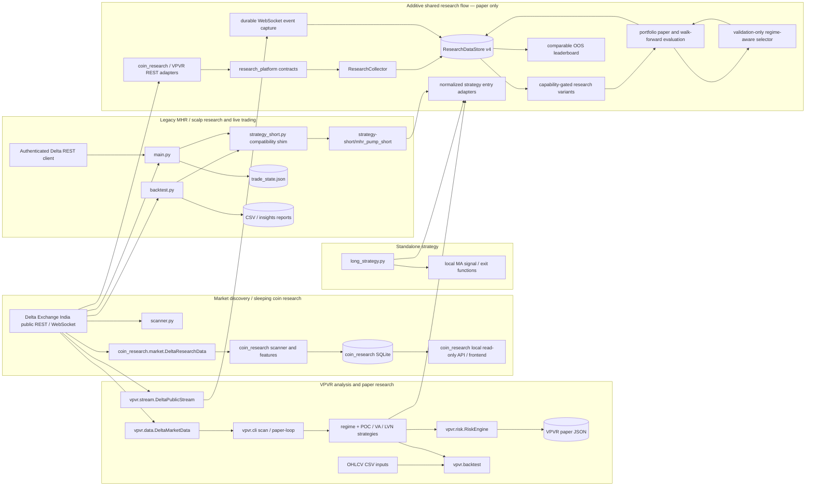

# Unified Research Platform: Architecture and Gap Audit

## Scope and conclusion

This document began as a Phase 1 audit and integration design. The progress
section below tracks additive research-platform work. Existing strategy
implementations, the `coin_research` scanner, VPVR paper-only boundary, and
historical reports remain intact. The existing MHR order flow is not connected
to the research platform and requires an explicit `ENABLE_LIVE_ORDERS=true`
interlock to submit new entries. The shared paper
simulator gained an optional strict fold cutoff; its default path remains
compatible.

The repository contains useful independent building blocks, but not a unified
platform. The main integration gaps are duplicated exchange adapters,
incompatible market-data and signal schemas, siloed persistence, independent
risk/execution models, and incomplete cross-strategy research validation.
Integrate through adapters and explicit shared contracts; do not replace
working strategy implementations as a first step.

## Implementation progress

The following additive components are implemented in `research_platform/`.
Existing scanners and strategies remain independently usable, and the shared
research package is not connected to the live order loop.

- **Canonical contracts and capability-aware provider adapters:** typed
  instruments with separately verified contract specifications, candles,
  trades, tickers, order-book snapshots, funding observations, and data-quality
  records; adapters wrap `coin_research` and
  VPVR public REST clients. Exchange/source timestamps, aggressor side, and
  product metadata are retained. Candle timeframes and product-state coverage
  are declared per provider. Unsupported historical OI, liquidations, and reconstructed order-book deltas
  remain unavailable.
- **Canonical SQLite store v4:** stores product snapshots, candles, ticker
  snapshots, trade prints, L2 snapshots, funding, and quality records in a
  separate database. It is not a migration of the coin-research store, VPVR
  state, or historical reports. Inactive product metadata is retained;
  “not returned” is assigned only for an explicitly complete catalog snapshot.
  Version 2 added an experiment registry and persisted paper-simulation
  outputs; version 3 adds per-variant evaluation records; version 4 adds
  durable raw WebSocket event capture and stream-health history. The canonical
  store remains separate from historical stores.
- **Collector service:** reconciles the provider catalog and writes observations
  through the canonical store. It batch-fetches tickers and does not request
  live book/trade observations for non-live instruments. Unsupported fields
  and empty results are recorded as unavailable rather than fabricated.
- **Strategy entry adapters:** normalized signal records and adapters now wrap
  MHR Exhaustion, Scalp Pullback, Fast/Slow MA, POC Reclaim, Value Area
  Rejection, and LVN Breakout. Signal context excludes candles that have not
  closed as of the decision time. Sizing stays separate; legacy quantity is
  diagnostic only.
- **Strategy exit adapters:** wrappers now normalize outcomes from the existing
  MHR, Scalp Pullback, and Fast/Slow MA exit simulators without changing their
  execution rules. MHR's partial and remainder PnL remain separate. The
  outcomes are labeled gross/pre-cost; they are not reported as net results.
  VPVR exposes a normalized stop/target/trailing plan but continues to process
  exits through its native paper engine; there is no shared exit simulator or
  live-loop integration.
- **Runnable collection and dashboard:** `python -m research_platform collect`
  reconciles and captures supported public observations; `serve` starts a
  loopback-only read-only dashboard/API. The UI shows the instrument catalog,
  observations and coverage, capabilities, experiment records, and paper
  simulation results. Collection failures are recorded per instrument.
  Optional `collect --websocket-capture --loop-seconds N` persists events from
  the existing VPVR public stream on the SQLite-owning thread, shards
  subscriptions to the stream's 100-symbol limit, and reports reconnect,
  failure, and queue-drop observations. Raw book events retain
  `integrity=not_provided`; this does not implement book reconstruction,
  sequence-gap detection, or replay.
- **Aligned timeframe derivation:** when a requested timeframe is not directly
  provided, the collector derives it from the largest available aligned lower
  timeframe only when every expected source candle is present and complete.
  Derived rows retain a derived-source label and flag; missing source intervals
  do not generate synthetic candles. The collector supports requested canonical
  timeframes through direct or valid lower-timeframe observations.
- **Paper simulation and validation utilities:** a constrained single-trade
  OHLCV simulator uses verified contract specifications, explicit spread,
  slippage and fees, and conservative ambiguous-bar handling. Chronological
  train/validation/OOS splitting supports an embargo. Descriptive paper-result
  summaries retain rejected candidates and explicitly make no significance or
  confidence-interval claim. Uncosted legacy exit outcomes are excluded from
  net-PnL aggregation.
- **Research variant suite:** registers ten independent strategy families with
  explicit evidence requirements. Five candle-based variants have
  research-only signal implementations (including a clearly labeled
  candle-extreme sweep proxy); variants requiring historical absorption,
  liquidation, funding/basis, complete trade tape, or synchronized book data
  remain unavailable or capability-gated. No OHLCV history is described as
  order-book absorption.
- **Portfolio and walk-forward paper evaluation:** adds portfolio-level
  open-slot, gross-notional, and stop-risk gates on top of the costed,
  contract-verified single-trade simulator. The `backtest` CLI reads stored
  candles, builds expanding chronological folds, hashes the dataset and
  contract metadata, records each experiment and trade outcome, and keeps
  discovered products with missing history in coverage. It also reports an
  approximate Deflated-Sharpe diagnostic, IID and circular moving-block
  expectancy intervals; these remain sensitivity diagnostics, not
  selection-adjusted inference or independent replication. The CLI does not load complete historical trades/books/funding,
  so those candidates remain visibly insufficient or unavailable.
  Every validation and OOS portfolio receives an explicit exit cutoff. Only
  completed 1m candles closing at or before that cutoff are considered. A
  position still open at the fold boundary is conservatively closed at the
  last eligible candle close with exit reason `FOLD_END`; exit availability is
  timestamped at candle close, not candle start.
- **Validation-gated strategy selection:** each fold derives per-symbol OHLCV
  regimes from completed 1h candles, evaluates candidate strategies on the
  validation window, and selects for OOS only when that strategy/regime has at
  least three simulated validation trades and positive net expectancy.
  Insufficient or negative evidence yields an explicit no-trade decision.
  Selector decisions and paper outcomes are persisted as separate experiments
  and exposed by the read-only dashboard. Same-product overlaps and
  same-direction trades with high, unavailable, or undefined recent aligned
  1m return correlation are rejected. These gates are safeguards, not a sector
  model or full portfolio stress test.
- **Read-only subsystem summary:** the dashboard now reports available
  coin-research summary, ranked sleeping candidates, recent coin-research
  events/outcomes, VPVR paper-state summary, and MHR report-file inventory
  alongside canonical platform data. It remains a read-only cross-store view.
- **Comparable OOS leaderboard:** completed walk-forward experiments are
  grouped by dataset/run, aggregated by independent strategy and selector,
  and ranked by net PnL after costs. The API reports trade counts, fold
  periods, execution assumptions, fold drawdown, and selector difference to
  best standalone strategy. Comparability is explicitly false when OOS periods
  or execution assumptions differ. Standalone strategies and the selector compound
  equity sequentially across non-overlapping OOS folds; fold-end settlement is
  applied before the next fold's position sizing.
- **Legacy live-entry safety:** the existing MHR order path is still isolated
  from research strategies and now blocks new entries unless
  `ENABLE_LIVE_ORDERS=true`. Entry completion is checked through the SDK's
  order-by-ID response; partial fills are sized to the confirmed quantity,
  stop-order enum/response handling follows the installed Delta SDK, and an
  unconfirmed protective stop triggers a reduce-only emergency-close request.
  Ambiguous order status or stop failure persists an execution halt in
  `trade_state.json` until an operator reconciles positions and clears it.
  These behaviors are covered with mocked clients only; live exchange response
  and recovery behavior remain unverified.

## Current master-task checklist

- [x] Preserve MHR, scalp, Fast/Slow MA, VPVR, legacy reports, and live order path.
- [x] Add canonical registry, provider adapters, coverage records, and additive SQLite migrations.
- [x] Derive canonical timeframes only from complete, aligned lower-timeframe candles.
- [x] Persist available WebSocket events and expose queue loss/reconnect health.
- [x] Keep unsupported book/OI/liquidation/funding history explicit; never fabricate it.
- [x] Add independent paper strategy variants, contract-aware cost model, portfolio gates, and selector.
- [x] Enforce completed-candle fold exits and persist an explicit fold-end close policy.
- [x] Compound standalone and selector equity across strictly non-overlapping OOS folds.
- [x] Require explicit `ENABLE_LIVE_ORDERS=true` before the existing MHR entry path can place an order.
- [x] Expose market/feed events, legacy research summaries, experiments, and OOS comparisons in a loopback-only dashboard.
- [ ] Validate public WebSocket capture against the live exchange and implement sequence-aware book resync/replay.
- [ ] Obtain/verify broader historical trade, book, funding, mark/index, OI, and liquidation coverage.
- [ ] Complete depth/impact, partial fills, latency, funding cash flow, margin/liquidation, and portfolio stress execution models.
- [ ] Integrate legacy and VPVR strategies into identical-cost walk-forward runs without changing their implementations.
- [x] Add a circular moving-block expectancy interval alongside the IID interval.
- [ ] Complete selection-adjusted statistical validation and independent replication.
- [ ] Pass full end-to-end live-feed/recovery and product-contract acceptance tests.

Start collection with persistent raw WebSocket capture (requires network access):

```bash
.venv/bin/python -m research_platform collect \
  --provider coin-research --timeframe 1h \
  --loop-seconds 300 --websocket-capture
.venv/bin/python -m research_platform serve --host 127.0.0.1 --port 8766
```

Higher canonical timeframes can be requested when the provider supplies an
aligned lower timeframe; the collector records source and derived candle rows
separately. No WebSocket capture or live exchange request was made for this
implementation run.

**Remaining before claiming integration:** the platform is additive and
research-only, not a fully integrated trading research stack. The shared
simulator still lacks depth/impact, partial fills, latency, funding cash
flows, margin/liquidation and portfolio correlation stress scenarios.
Standalone and selector equity now compound across strictly non-overlapping
OOS folds; the reported moving-block interval is a limited dependence
sensitivity diagnostic, not a fully dependence-robust inference method. The selector uses
simple validation expectancy gating and is not selection-adjusted. Regimes
use OHLCV proxies only. Historical OI, liquidations, reconstructed
order-book deltas, and validated synchronized depth history remain
unsupported. The existing MHR live order path remains separate from research
signals and is not enabled by default; its new-entry route fails closed unless
`ENABLE_LIVE_ORDERS=true` is explicitly configured. No live request or order was
sent during this work.

## 1. Current dependency and data-flow map



`scanner.py` and the live loop in `main.py` also have their own ticker/product
access paths. `coin_research` currently has a local dashboard over its own
store; it is not yet a unified dashboard over VPVR and legacy reports.

## 2. Gap matrix

| Area | Current implementation | Gap / consequence | Integration direction |
|---|---|---|---|
| Instrument discovery | `coin_research` paginates perpetual product metadata across states; `vpvr.data` and `scanner.py` have separate catalog paths; `main.py` applies its own live filters. | No canonical instrument identity/history or single reconciliation contract. VPVR contract-spec verification is limited to explicit BTC/ETH sizing policies; unknown products fail closed for sizing. | Preserve source metadata and product-state transitions in a registry keyed by stable exchange product ID. Include all discovered contracts; classify insufficiently observed/new listings separately. |
| REST market data | `coin_research.market.DeltaResearchData`, `vpvr.data.DeltaMarketData`, `backtest.py` fetch helpers, `scanner.py`, and `main.py` independently call Delta endpoints. | Request, normalization, retry, timestamp, and completeness semantics differ. `coin_research` currently requests 1m/5m/1h candles; VPVR has 1m/3m/15m and funding/trade/book REST methods; the legacy backtest is primarily 1m/1h. | Add a shared provider interface and normalized records, initially wrapping existing adapters. Keep endpoint-specific limitations visible. |
| WebSocket data | `vpvr.stream.DeltaPublicStream` feeds `research_platform.DurableMarketCapture`, which persists raw public ticker/trade/funding/L1/L2/candle events and connection/reconnect/drop health to SQLite. Buyer role is intentionally not treated as aggressor side. | No sequence-gap detection, snapshot/delta reconstruction, replay, or validated synchronized depth history; raw L2 integrity remains `not_provided`. | Add a verified sequence-aware resync/replay protocol; retain “unknown” rather than infer aggressor side or book integrity. |
| Timeframes / history | Canonical timeframes cover 1m, 3m, 5m, 15m, 1h, 4h, and 1d; unsupported direct intervals derive from a complete, aligned lower interval with source lineage. | No live service validation of all provider range/retention limits. Large 4h/1d backfills through 1m-only sources can be expensive. | Continue measuring source completeness/freshness; derive only from exact constituent candles and preserve lineage. |
| Trades / order book | REST adapters can return recent public trades and book snapshots; VPVR stream buffers selected events. | No common timestamped trade schema; side semantics differ. There is no persisted historical book-delta feed or validated historical depth series. | Canonical trade and book contracts must include source, timestamp, side semantics, sequence/sync metadata, and coverage. Do not reconstruct historical absorption from candles. |
| Funding / OI / mark-index | VPVR has current/historical funding helpers and market snapshots; adapters have access to some ticker price fields. | No unified aligned funding observation. Historical open interest is not currently represented in a shared provider/store. Historical liquidation events are not represented. | Mark unsupported capabilities explicitly. Verify available Delta endpoints and retention before enabling a strategy that requires these inputs. Never fabricate missing history. |
| Persistence / lineage | `coin_research` uses SQLite; VPVR paper state is JSON; legacy reports are CSV/Markdown. The additive canonical SQLite store v4 preserves product metadata, observations, raw WebSocket events/health, experiment runs, variant evaluations, and paper outcomes. | Canonical persistence is separate; existing stores are read-only summaries and are not normalized/imported into a common history. | Preserve source stores and add import/read adapters only with explicit provenance; do not overwrite historic reports in-place. |
| Sleeping / awakening | `coin_research` computes per-symbol features, state and shadow outcomes and has separate discovery/execution eligibility. | This is the closest existing foundation, but it does not yet unify all timeframes, persisted flow data, OI/funding changes, or cross-system candidates. | Extend through explicit feature contracts and quality/freshness fields. Keep low-liquidity instruments visible even when execution-ineligible. |
| Strategy interface | MHR/scalp return dictionaries; Fast/Slow MA returns dictionaries and has separate exit helpers; VPVR uses `StrategySignal` and its own regime/strategy APIs. | Different timestamps, provenance, stop/target semantics, sizing coupling, and required-data declarations prevent consistent scheduling and comparison. | Add a normalized strategy adapter/protocol. Wrap existing code unchanged; strategy emits a signal, risk sizing and execution simulation consume it separately. |
| Strategy coverage | Existing six strategy entry adapters remain; the variant suite registers ten independent families and implements five OHLCV-based research variants. The validation-gated selector is connected to walk-forward paper evaluation. | Legacy and VPVR strategies are not all dispatched through this runner. Absorption, liquidation, and basis/funding variants are unavailable; trade-flow and book strategies require data the CLI does not load. | Expand only with valid evidence and preserve strategy-specific provenance. Do not infer missing data or treat related diagnostics as validated variants. |
| Risk / contract sizing | Legacy strategy risk remains separate; the new OHLCV paper simulator sizes from verified contract rules. Portfolio admission caps stop risk, gross exposure, slots, same-product overlap, and same-direction pairwise correlation. | No shared contract sizing integration in legacy/VPVR paths; no full sector or portfolio stress/correlation model. | Preserve separate strategy sizing and use verified specs; improve stress and correlation only from aligned data. |
| Execution simulation | A shared paper portfolio runner composes the single-trade OHLCV simulator and applies explicit fees, spread, slippage, stop-first ambiguity, exposure limits, and fail-closed correlation gates. | No partial fills, latency, depth/impact, funding cash flows, maintenance margin/liquidation, or full portfolio stress. OHLCV cannot resolve all intrabar ordering. | Add validated market microstructure and funding/margin models. Keep simulator isolated from live client. |
| Validation / ranking | Walk-forward CLI stores dataset/config versions, standalone OOS outcomes, per-symbol coverage, approximate DSR plus IID/moving-block intervals, and a selector fitted only from prior validation outcomes. | No selection-adjusted leaderboard or independent replication; moving-block intervals remain assumption-sensitive. Only implemented OHLCV variants are scored by CLI. | Extend evidence quality without using OOS outcomes for selection; report coverage, costs, and limitations for every product. |
| Dashboard | The local read-only UI/API exposes canonical observations, raw stream events/health, experiments, OOS leaderboard groups, evaluations, selector decisions, paper outcomes, and source-specific coin research/VPVR/MHR summaries. | It does not normalize historic subsystem trades or claim pooled cross-subsystem performance; unsupported depth/market-regime diagnostics remain unavailable. | Preserve read-only behavior; add cross-subsystem performance only after source alignment and coverage checks. |
| Live boundary | `main.py` contains authenticated order placement and position management; `ENABLE_LIVE_ORDERS=false` blocks new entries by default, while `AUTO_EXECUTE=false` adds a confirmation prompt after the interlock is armed. Fill quantity and protective-stop response handling are tested with mocks; ambiguous states persist a manual-review halt. VPVR paper mode is separate. | Research signals are not routed into the legacy MHR order flow; live exchange response, network-failure, idempotency, and operational recovery have not been validated. | Keep new research orchestration shadow/paper-only; validate the MHR flow with exchange test facilities before any real-fund use. |

## 3. Shared interfaces and remaining integration

Typed, versioned market-data, strategy-signal, and simulator contracts exist in
`research_platform/`. The interfaces remain an additive layer; existing
subsystems are not all wired through them. Preserve raw source payloads or
source identifiers when extending the adapters.

1. **Instrument registry**
   - Stable exchange product ID, symbol, contract type, state/status, listing and
     last-seen/reconciled timestamps, raw metadata, and normalized contract
     specifications with verification status.
   - Preserve inactive/delisted metadata and transitions. “New listing” is an
     observation-age/data-coverage classification, not a symbol exclusion.
2. **Market observations**
   - `Candle`: product ID, canonical interval, open/close timestamps, OHLCV,
     source, completeness, and whether observed or derived.
   - `TradePrint`: exchange and receive timestamps, trade ID, price, quantity,
     notional, and explicit aggressor side (`buy`, `sell`, or `unknown`) plus
     source semantics.
   - `OrderBookSnapshot` / `OrderBookDelta`: timestamp, levels, source,
     sequence/checksum where supplied, and synchronized/gap status.
   - `FundingObservation`, `OpenInterestObservation`, and mark/index observations
     carry their own timestamps, source, units, and freshness.
   - `DataQuality`: freshness, completeness, gaps, sequence integrity,
     capability/availability, and confidence inputs. Unsupported is distinct
     from zero or an empty-but-valid observation.
3. **Provider capabilities**
   - A provider declares supported products, timeframes, fields, history depth,
     timestamp rules, and live/historical/derived status. Normalize supported
     data without promising unavailable historical depth/OI/liquidations.
4. **Strategy specification and signal**
   - Strategy ID/version, required fields/timeframes, applicable regime, and
     signal decision timestamp.
   - Signal direction, entry/exit conditions, stop/target/invalidation
     references, and data/feature provenance. A signal does not choose account
     quantity or place an order.
5. **Risk and simulation**
   - Risk decision accepts a signal, verified contract specs, portfolio state,
     and explicit cost/limit assumptions; it returns accepted/rejected with
     reasons and quantity rounded to exchange rules.
   - Simulator consumes accepted paper decisions and timestamped market data,
     records assumptions/fills/cash flows, and has no authenticated client or
     live-order dependency.
6. **Research experiment**
   - Dataset/version, strategy/version/config, chronological split boundaries,
     universe coverage, missing-data accounting, cost model, simulator version,
     per-symbol outcomes, pooled metrics, and reproducible artifacts.

### Critical state distinction

Discovery eligibility answers “can this instrument be observed well enough to
classify and monitor?” Execution eligibility answers “can this specific
proposed order be executed within validated cost and risk limits?” They must be
separate persisted decisions. Spread, depth, impact, lot-size verification, or
minimum order constraints may reject execution but must not remove a product
from discovery or research coverage.

## 4. Remaining staged implementation plan

| Stage | Status | Work | Exit criteria / safety gate |
|---|---|---|---|
| 0. Contract and capability agreement | Foundation implemented | Typed instrument, observation, quality, provider, strategy, and signal contracts; source coverage declared. Risk and experiment contracts remain to be finalized with their consumers. | Contract tests pass; no adapter claims unsupported data. |
| 1. Registry and provider wrappers | Partial | Canonical product records and adapters over coin research / VPVR clients exist. They are not yet wired into existing scanner or CLI workflows. | All products reconciled; newly listed/inactive products retained; adapter parity for source-specific units and timestamps. |
| 2. Aligned persistence | Partial | Additive schema v4, collector CLI, strict complete-bar timeframe derivation, durable raw WebSocket event capture, experiment and outcome persistence, and coverage queries store supported observations separately from historical stores. No import migration or unattended service manager integration. | Idempotent writes, coverage/gap reporting, provenance, restart recovery, and existing store tests pass. |
| 3. Strategy adapters | Entry wrappers implemented; exit normalization partial | Entry adapters wrap the six existing strategies. MHR, Scalp, and Fast/Slow exit simulators have normalized result wrappers; VPVR has a normalized plan but remains on its native paper engine. No common exit callback contract or live integration exists. | Parity fixtures show wrapper outputs match legacy behavior; no changes to MHR/live behavior; all signals contain timestamp and provenance; remaining VPVR behavior and stateful exits are explicitly covered. |
| 4. Research variants | Partial; OHLCV variants implemented | Five OHLCV-based variants have research-only signals; trade-flow and book variants require evidence not loaded by the current backtest CLI. Absorption, liquidation, and basis/funding variants remain unavailable. | Per-variant unit tests, no-lookahead and source-validity tests; valid trade/book history is required before enabling those variants. |
| 5. Common simulator | Partial; constrained portfolio paper simulation implemented | Verified contract rules, fees, spread, slippage, stop gaps, conservative intrabar ambiguity, explicit fold-boundary exits, portfolio slots, notional, stop-risk, and same-direction correlation gates are modeled. No depth/impact, latency, partial fills, funding, margin/liquidation, or correlation stress. | Add validated market-impact/fill/funding/margin models. Simulator remains isolated from live client. |
| 6. Validation / experiments | Partial; walk-forward CLI implemented | Schema-v4 registry, expanding chronological folds, strict completed-candle fold cutoff, explicit open-position boundary close, embargo/purge helpers, IID and moving-block expectancy intervals, approximate DSR, compounded OOS folds, and persisted per-trade outcomes exist. Statistical checks remain approximations. | Add selection controls, robustness testing, and independent replication. Include all discovered products in coverage. |
| 7. Strategy selection / portfolio | Partial; validation-gated selector implemented | Validation-period per-regime expectancy gates OOS selection and permits no-trade; same-product overlaps and high/unestimable same-direction pairwise correlation are rejected. Sequential fold compounding exists; there is no sector stress model or selector robustness/selection adjustment. | Add deeper dependency/correlation stress and unseen independent confirmation. |
| 8. Unified read-only dashboard | Partial; live capture and OOS summaries surfaced | Local read-only API/UI exposes canonical data, raw market events, stream health, evaluations, experiments, simulations, coin-research candidates/events, VPVR paper state, MHR report inventory, and comparable OOS leaderboard groups. It does not normalize every subsystem's trade-level data. | Keep reads read-only; add cross-subsystem data normalization only with explicit provenance and coverage tests. |
| 9. Validation | Partial | Unit/integration tests cover strict fold cutoff, derived-bar completeness, durable event persistence, and dashboard queries; fixtures do not validate live exchange recovery, sequence-aware book resync, all strategy no-lookahead behavior, or every contract rule. | Add feed outage/resync, contract-size, broader no-lookahead, and independent cross-strategy data tests. |

At every stage, shadow/paper output only. Changes to date leave the MHR
implementation, `main.py`, existing live order behavior, and historical
reports untouched.

## 5. Validation performed and remaining

### Existing tests

The latest focused and repository-wide runs used:

```text
.venv/bin/python -m unittest discover -s tests -p 'test_research_platform*.py'
Ran 85 tests
OK

.venv/bin/python -m unittest discover -s tests
Ran 144 tests
OK
```

Compilation, CLI help, dashboard JavaScript syntax, and `git diff --check` also
pass. Fixture tests are not evidence of live Delta connectivity or complete
end-to-end integration.

### Not implemented or verified in this audit

- No-lookahead behavior across all legacy strategies and every derived-timeframe join.
- Full-universe end-to-end catalog reconciliation and delisted history.
- Sequence-gap detection and WebSocket resynchronization/replay; capture stores
  raw book events with unknown integrity rather than asserting synchronization.
- Historical trade/book data completeness and valid absorption evidence.
- Open-interest and liquidation history availability/quality.
- Cross-strategy cost/fill comparison, compounded multi-fold portfolio
  accounting, legacy-strategy fair comparison, and statistical robustness
  beyond the implemented approximations.
- Shared frontend coverage of all subsystems' normalized trade-level data;
  source-specific read-only summaries are exposed, but not pooled.
- Compatibility against live Delta product rules for every contract.

## 6. Explicit limitations and non-goals

- This report does not claim the repository is integrated or that the research
  question has a positive answer.
- There is no evidence here that historical order-book absorption, liquidation
  cascades, or historical OI can be reconstructed for the required periods.
- Existing backtest outputs and strategies have not been independently
  revalidated as OOS evidence by this architecture audit.
- `long_strategy.py` is standalone; its signal helpers calculate strategy-local
  sizing and are not dispatched by the existing backtest/live stack.
- Existing live order placement in `main.py` remains separate from research.
  New entries now fail closed unless `ENABLE_LIVE_ORDERS=true`; only mocked
  client responses were used in tests, and no exchange request was sent.
- This work preserves existing subsystem stores and reports and keeps the
  exchange-authenticated order flow outside the research package.
