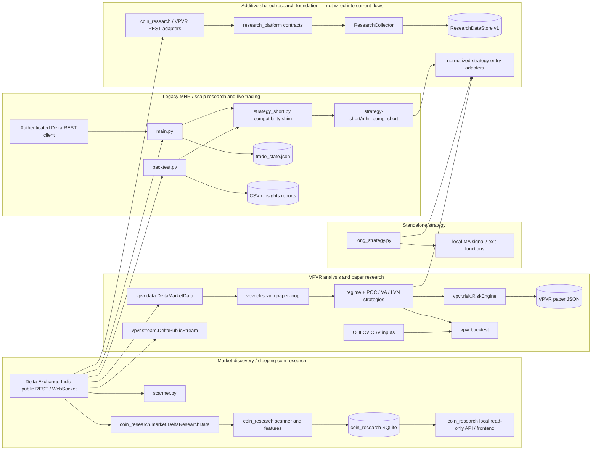

# Unified Research Platform: Architecture and Gap Audit

## Scope and conclusion

This document began as a Phase 1 audit and integration design. The progress
section below records the first additive implementation slices. No existing
strategy, backtest, paper-trading, or live-order behavior has been changed. The
existing `coin_research` scanner and VPVR paper-only boundary remain intact.

The repository contains useful independent building blocks, but not a unified
platform. The main integration gaps are duplicated exchange adapters,
incompatible market-data and signal schemas, siloed persistence, independent
risk/execution models, and incomplete cross-strategy research validation.
Integrate through adapters and explicit shared contracts; do not replace
working strategy implementations as a first step.

## Implementation progress — 2026-10-30

The following foundation is now implemented in the new `research_platform/`
package. These are additive components; existing scanners, strategy dispatch,
CLI behavior, and live execution paths do not call them yet.

- **Canonical contracts and capability-aware provider adapters:** typed
  instruments with separately verified contract specifications, candles,
  trades, tickers, order-book snapshots, funding observations, and data-quality
  records; adapters wrap `coin_research` and
  VPVR public REST clients. Exchange/source timestamps, aggressor side, and
  product metadata are retained. Candle timeframes and product-state coverage
  are declared per provider. Unsupported historical OI, liquidations, and
  order-book deltas remain unavailable.
- **Canonical SQLite store v1:** stores product snapshots, candles, ticker
  snapshots, trade prints, L2 snapshots, funding, and quality records in a
  separate database. It is not a migration of the coin-research store, VPVR
  state, or historical reports. Inactive product metadata is retained;
  “not returned” is assigned only for an explicitly complete catalog snapshot.
- **Collector service:** reconciles the provider catalog and writes observations
  through the canonical store. It batch-fetches tickers and does not request
  live book/trade observations for non-live instruments. Unsupported fields
  and empty results are recorded as unavailable rather than fabricated.
- **Strategy entry adapters:** normalized signal records and adapters now wrap
  MHR Exhaustion, Scalp Pullback, Fast/Slow MA, POC Reclaim, Value Area
  Rejection, and LVN Breakout. Signal context excludes candles that have not
  closed as of the decision time. Sizing stays separate; legacy quantity is
  diagnostic only. This slice does not yet normalize strategy exit callbacks
  or put any adapter into the existing live loop.
- **Verification:** 83 repository tests pass, including the 59 pre-existing
  tests and 24 new tests for canonical contracts, provider boundaries,
  persistence, collector behavior, and entry adapters. Compilation and
  `git diff --check` pass. Tests use fixtures and do not make exchange requests.

**Remaining before claiming integration:** no CLI/scheduled runner or existing
scanner is wired to the collector; no production database has been migrated;
the shared store has no unified dashboard/API; strategy exits are not yet
normalized; the new research families, common execution simulator, portfolio
risk, experiment registry, chronological OOS/walk-forward validation, and
cross-system end-to-end feed tests remain unimplemented. This is a working
foundation, not the complete platform.

## 1. Current dependency and data-flow map



`scanner.py` and the live loop in `main.py` also have their own ticker/product
access paths. `coin_research` currently has a local dashboard over its own
store; it is not yet a unified dashboard over VPVR and legacy reports.

## 2. Gap matrix

| Area | Current implementation | Gap / consequence | Integration direction |
|---|---|---|---|
| Instrument discovery | `coin_research` paginates perpetual product metadata across states; `vpvr.data` and `scanner.py` have separate catalog paths; `main.py` applies its own live filters. | No canonical instrument identity/history or single reconciliation contract. VPVR contract-spec verification is limited to explicit BTC/ETH sizing policies; unknown products fail closed for sizing. | Preserve source metadata and product-state transitions in a registry keyed by stable exchange product ID. Include all discovered contracts; classify insufficiently observed/new listings separately. |
| REST market data | `coin_research.market.DeltaResearchData`, `vpvr.data.DeltaMarketData`, `backtest.py` fetch helpers, `scanner.py`, and `main.py` independently call Delta endpoints. | Request, normalization, retry, timestamp, and completeness semantics differ. `coin_research` currently requests 1m/5m/1h candles; VPVR has 1m/3m/15m and funding/trade/book REST methods; the legacy backtest is primarily 1m/1h. | Add a shared provider interface and normalized records, initially wrapping existing adapters. Keep endpoint-specific limitations visible. |
| WebSocket data | `vpvr.stream.DeltaPublicStream` buffers ticker/trade/funding/L1/L2/candle events in bounded memory. | No durable event history or complete persisted resync/sequence-integrity contract; stream data is not aligned with REST or the research store. Buyer role is intentionally not treated as aggressor side. | Persist only supported, explicitly sourced events. Model sync status, sequence gaps, and aggressor provenance; retain “unknown” rather than infer. |
| Timeframes / history | Existing surfaces cover overlapping but inconsistent subsets of 1m, 3m, 5m, 15m, and 1h. | Requested 4h and 1d data is not a shared capability. Resampling and closed-candle rules differ by caller. | Define canonical timeframe and candle-close rules. Derive higher timeframes only from complete, aligned lower-timeframe data and record derivation lineage. |
| Trades / order book | REST adapters can return recent public trades and book snapshots; VPVR stream buffers selected events. | No common timestamped trade schema; side semantics differ. There is no persisted historical book-delta feed or validated historical depth series. | Canonical trade and book contracts must include source, timestamp, side semantics, sequence/sync metadata, and coverage. Do not reconstruct historical absorption from candles. |
| Funding / OI / mark-index | VPVR has current/historical funding helpers and market snapshots; adapters have access to some ticker price fields. | No unified aligned funding observation. Historical open interest is not currently represented in a shared provider/store. Historical liquidation events are not represented. | Mark unsupported capabilities explicitly. Verify available Delta endpoints and retention before enabling a strategy that requires these inputs. Never fabricate missing history. |
| Persistence / lineage | `coin_research` uses SQLite for products, observations, events, and shadow outcomes. VPVR paper state is JSON; VPVR backtests write JSON; legacy reports are CSV/Markdown; `main.py` state is JSON. | No shared schema, experiment registry, dataset version, feature lineage, or cross-subsystem query model. | Introduce a versioned research store in stages. Preserve current stores and add import/read adapters; do not migrate or overwrite historic reports in-place. |
| Sleeping / awakening | `coin_research` computes per-symbol features, state and shadow outcomes and has separate discovery/execution eligibility. | This is the closest existing foundation, but it does not yet unify all timeframes, persisted flow data, OI/funding changes, or cross-system candidates. | Extend through explicit feature contracts and quality/freshness fields. Keep low-liquidity instruments visible even when execution-ineligible. |
| Strategy interface | MHR/scalp return dictionaries; Fast/Slow MA returns dictionaries and has separate exit helpers; VPVR uses `StrategySignal` and its own regime/strategy APIs. | Different timestamps, provenance, stop/target semantics, sizing coupling, and required-data declarations prevent consistent scheduling and comparison. | Add a normalized strategy adapter/protocol. Wrap existing code unchanged; strategy emits a signal, risk sizing and execution simulation consume it separately. |
| Strategy coverage | MHR Exhaustion and Scalp Pullback are dispatched by `backtest.py`; Fast/Slow MA is standalone; VPVR implements POC Reclaim, Value Area Rejection, and LVN Breakout. | No common dispatch or comparison. The additional auction-failure, VWAP-retest, absorption, sweep, flow, liquidation, basis/funding, trend-continuation, and volatility-breakout variants are not a unified strategy set. Some VPVR/coin-research diagnostics overlap conceptually but are not equivalent validated strategies. | Register each independent strategy with explicit data requirements and evidence status. Do not imply a family exists just because a related feature is present. |
| Risk / contract sizing | MHR sizing and live quantity adjustment are separate; `long_strategy` computes its own quantities; VPVR `RiskEngine` uses contract specs; VPVR backtest has separate quantity logic. | Risk budgets, fee/slippage assumptions, contract handling, and rounding are not shared. Unsupported contract specifications must not be papered over with defaults. | A common risk-decision interface should validate current product metadata, lot/minimum/tick/limit and reject unknown specs. Keep risk calculation independent from strategy signal generation. |
| Execution simulation | `backtest.py` has legacy MHR/scalp simulators; VPVR has a separate event-driven single-symbol backtester using 1m/3m/15m CSV inputs. | No common portfolio simulator or consistent fills, partial fills, latency, market impact, funding cash flow, margin/liquidation, or portfolio exposure accounting. OHLCV bars cannot resolve all intrabar ordering. | Build a standalone paper/backtest execution engine behind a simulator boundary. Specify conservative ambiguity handling and record assumptions per run. Do not connect it to live order placement. |
| Validation / ranking | Backtests produce strategy-specific reports. VPVR backtest documents some approximations and stop-first ambiguity policy. | No common chronological train/validation/OOS or walk-forward framework, purging/embargo, experiment registry, selection-bias correction, confidence intervals, or pooled all-symbol ranking. | Version datasets, configs, and results; report per-symbol and pooled results, regime splits, coverage, costs, and uncertainty. Keep never-awakened/no-trade symbols in denominators and discovery records. |
| Dashboard | The coin research frontend/API reads the coin research store; VPVR has CLI output; historical reports are files. | No unified view of the complete universe, cross-strategy leaderboard, paper portfolio, feed health, or event outcomes. | Build a read-only unified query layer and dashboard after shared storage/API contracts exist. Existing coin research views remain available during transition. |
| Live boundary | `main.py` contains authenticated order placement and position management; `AUTO_EXECUTE=false` requires confirmation but can be enabled. VPVR paper mode is separate. | A research integration must not accidentally route normalized signals into the existing order path. | Keep all new orchestration shadow/paper-only. No changes to `main.py`, authenticated client, or order behavior in this audit or initial integration stages. |

## 3. Shared interfaces to design before integration

These are proposed contracts, not implementations. Use typed, versioned records
and preserve raw source payloads or source identifiers where appropriate.

1. **Instrument registry**
   - Stable exchange product ID, symbol, contract type, state/status, listing and
     last-seen/reconciled timestamps, raw metadata, and normalized contract
     specifications with verification status.
   - Preserve inactive/delisted metadata and transitions. “New listing” is an
     observation-age/data-coverage classification, not a symbol exclusion.
2. **Market observations**
   - `Candle`: product ID, canonical interval, open/close timestamps, OHLCV,
     source, completeness, and whether observed or derived.
   - `TradePrint`: exchange and receive timestamps, trade ID, price, quantity,
     notional, and explicit aggressor side (`buy`, `sell`, or `unknown`) plus
     source semantics.
   - `OrderBookSnapshot` / `OrderBookDelta`: timestamp, levels, source,
     sequence/checksum where supplied, and synchronized/gap status.
   - `FundingObservation`, `OpenInterestObservation`, and mark/index observations
     carry their own timestamps, source, units, and freshness.
   - `DataQuality`: freshness, completeness, gaps, sequence integrity,
     capability/availability, and confidence inputs. Unsupported is distinct
     from zero or an empty-but-valid observation.
3. **Provider capabilities**
   - A provider declares supported products, timeframes, fields, history depth,
     timestamp rules, and live/historical/derived status. Normalize supported
     data without promising unavailable historical depth/OI/liquidations.
4. **Strategy specification and signal**
   - Strategy ID/version, required fields/timeframes, applicable regime, and
     signal decision timestamp.
   - Signal direction, entry/exit conditions, stop/target/invalidation
     references, and data/feature provenance. A signal does not choose account
     quantity or place an order.
5. **Risk and simulation**
   - Risk decision accepts a signal, verified contract specs, portfolio state,
     and explicit cost/limit assumptions; it returns accepted/rejected with
     reasons and quantity rounded to exchange rules.
   - Simulator consumes accepted paper decisions and timestamped market data,
     records assumptions/fills/cash flows, and has no authenticated client or
     live-order dependency.
6. **Research experiment**
   - Dataset/version, strategy/version/config, chronological split boundaries,
     universe coverage, missing-data accounting, cost model, simulator version,
     per-symbol outcomes, pooled metrics, and reproducible artifacts.

### Critical state distinction

Discovery eligibility answers “can this instrument be observed well enough to
classify and monitor?” Execution eligibility answers “can this specific
proposed order be executed within validated cost and risk limits?” They must be
separate persisted decisions. Spread, depth, impact, lot-size verification, or
minimum order constraints may reject execution but must not remove a product
from discovery or research coverage.

## 4. Remaining staged implementation plan

| Stage | Status | Work | Exit criteria / safety gate |
|---|---|---|---|
| 0. Contract and capability agreement | Foundation implemented | Typed instrument, observation, quality, provider, strategy, and signal contracts; source coverage declared. Risk and experiment contracts remain to be finalized with their consumers. | Contract tests pass; no adapter claims unsupported data. |
| 1. Registry and provider wrappers | Partial | Canonical product records and adapters over coin research / VPVR clients exist. They are not yet wired into existing scanner or CLI workflows. | All products reconciled; newly listed/inactive products retained; adapter parity for source-specific units and timestamps. |
| 2. Aligned persistence | Initial slice implemented | Additive schema v1 and collector persist supported observations; current store is separate from historical stores. No production migration or scheduler/CLI ingestion path yet. | Idempotent writes, coverage/gap reporting, provenance, restart recovery, and existing store tests pass. |
| 3. Strategy adapters | Entry wrappers implemented | Entry adapters wrap the six existing strategies; shared exit callbacks and full parity validation remain. | Parity fixtures show wrapper outputs match legacy behavior; no changes to MHR/live behavior; all signals contain timestamp and provenance. |
| 4. Research variants | Not started | Implement each independent variant only when its required data capability is present. Keep unavailable variants explicitly disabled with reasons. | Per-variant unit tests, no-lookahead tests, and source-validity checks; absorption/order-flow variants require valid trade/book history. |
| 5. Common simulator | Not started | Add costs and fills incrementally: product rules, bid/ask, fees, slippage/impact, latency/partial fills, funding, ambiguous bars, margin and portfolio limits. | Deterministic fixtures for contract rounding, gap stops, same-bar ambiguity, fees/funding, and portfolio exposure. Simulator remains isolated from live client. |
| 6. Validation / experiments | Not started | Add chronological splits, walk-forward, embargo/purge where justified, dataset/config versioning, coverage-aware pooled and per-symbol metrics, uncertainty and selection-bias checks. | Reproducible OOS reports include every discovered product and distinguish no-data/no-event/no-trade from losses. |
| 7. Unified read-only dashboard | Not started | Build on canonical queries for universe, sleeping/awakening/expansion, strategy comparison, paper outcomes, data/feed quality, and per-symbol explanations. | API/UI integration tests; read-only by construction; existing coin research dashboard remains usable. |

At every stage, shadow/paper output only. The first integration PR should not
change the MHR implementation, `main.py`, existing live order behavior, or
historical reports. Review and test changes to those separately.

## 5. Validation performed and remaining

### Existing tests

Ran the unchanged repository test suite:

```text
.venv/bin/python -m unittest discover -s tests -v
Ran 59 tests in 3.997s
OK
```

This is a baseline test run, not evidence of unified data flow or
end-to-end integration. The repository has unit coverage for coin-research
discovery/features/store/API and VPVR calculations, market data, paper
boundaries, risk, and backtest behaviors. Tests for all the requested unified
contracts and cross-system flows do not yet exist.

### Not implemented or verified in this audit

- No-lookahead behavior across all strategies and derived timeframe joins.
- Full-universe end-to-end catalog reconciliation and delisted history.
- Sequence-gap detection and WebSocket resynchronization/replay.
- Historical trade/book data completeness and valid absorption evidence.
- Open-interest and liquidation history availability/quality.
- Cross-strategy cost/fill/portfolio comparison and walk-forward results.
- Shared frontend coverage of all subsystems.
- Compatibility against live Delta product rules for every contract.

## 6. Explicit limitations and non-goals

- This report does not claim the repository is integrated or that the research
  question has a positive answer.
- There is no evidence here that historical order-book absorption, liquidation
  cascades, or historical OI can be reconstructed for the required periods.
- Existing backtest outputs and strategies have not been independently
  revalidated as OOS evidence by this architecture audit.
- `long_strategy.py` is standalone; its signal helpers calculate strategy-local
  sizing and are not dispatched by the existing backtest/live stack.
- Existing live order placement in `main.py` is intentionally out of scope.
  No live order execution has been enabled or changed.
- The working tree contained pre-existing local coin-research frontend/backend
  changes from the preceding request. They were left untouched by this audit,
  which adds only this document.
