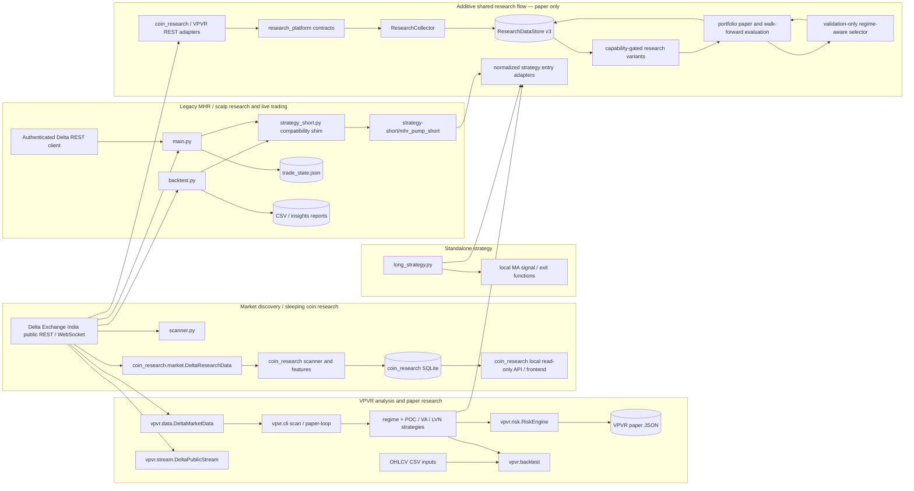

# Unified Research Platform: Architecture and Gap Audit

## Scope and conclusion

This document began as a Phase 1 audit and integration design. The progress
section below records the first additive implementation slices. No existing
strategy, backtest, paper-trading, or live-order behavior has been changed. The
existing `coin_research` scanner and VPVR paper-only boundary remain intact.

The repository contains useful independent building blocks, but not a unified
platform. The main integration gaps are duplicated exchange adapters,
incompatible market-data and signal schemas, siloed persistence, independent
risk/execution models, and incomplete cross-strategy research validation.
Integrate through adapters and explicit shared contracts; do not replace
working strategy implementations as a first step.

## Implementation progress

The following additive components are implemented in `research_platform/`.
Existing scanners and strategies remain independently usable, and the shared
research package is not connected to the live order loop.

- **Canonical contracts and capability-aware provider adapters:** typed
  instruments with separately verified contract specifications, candles,
  trades, tickers, order-book snapshots, funding observations, and data-quality
  records; adapters wrap `coin_research` and
  VPVR public REST clients. Exchange/source timestamps, aggressor side, and
  product metadata are retained. Candle timeframes and product-state coverage
  are declared per provider. Unsupported historical OI, liquidations, and
  order-book deltas remain unavailable.
- **Canonical SQLite store v3:** stores product snapshots, candles, ticker
  snapshots, trade prints, L2 snapshots, funding, and quality records in a
  separate database. It is not a migration of the coin-research store, VPVR
  state, or historical reports. Inactive product metadata is retained;
  “not returned” is assigned only for an explicitly complete catalog snapshot.
  Version 2 added an experiment registry and persisted paper-simulation
  outputs; version 3 adds per-variant evaluation records. The canonical store
  remains separate from historical stores.
- **Collector service:** reconciles the provider catalog and writes observations
  through the canonical store. It batch-fetches tickers and does not request
  live book/trade observations for non-live instruments. Unsupported fields
  and empty results are recorded as unavailable rather than fabricated.
- **Strategy entry adapters:** normalized signal records and adapters now wrap
  MHR Exhaustion, Scalp Pullback, Fast/Slow MA, POC Reclaim, Value Area
  Rejection, and LVN Breakout. Signal context excludes candles that have not
  closed as of the decision time. Sizing stays separate; legacy quantity is
  diagnostic only.
- **Strategy exit adapters:** wrappers now normalize outcomes from the existing
  MHR, Scalp Pullback, and Fast/Slow MA exit simulators without changing their
  execution rules. MHR's partial and remainder PnL remain separate. The
  outcomes are labeled gross/pre-cost; they are not reported as net results.
  VPVR exposes a normalized stop/target/trailing plan but continues to process
  exits through its native paper engine; there is no shared exit simulator or
  live-loop integration.
- **Runnable collection and dashboard:** `python -m research_platform collect`
  reconciles and captures supported public observations; `serve` starts a
  loopback-only read-only dashboard/API. The UI shows the instrument catalog,
  observations and coverage, capabilities, experiment records, and paper
  simulation results. Collection failures are recorded per instrument.
- **Paper simulation and validation utilities:** a constrained single-trade
  OHLCV simulator uses verified contract specifications, explicit spread,
  slippage and fees, and conservative ambiguous-bar handling. Chronological
  train/validation/OOS splitting supports an embargo. Descriptive paper-result
  summaries retain rejected candidates and explicitly make no significance or
  confidence-interval claim. Uncosted legacy exit outcomes are excluded from
  net-PnL aggregation.
- **Research variant suite:** registers ten independent strategy families with
  explicit evidence requirements. Five candle-based variants have
  research-only signal implementations (including a clearly labeled
  candle-extreme sweep proxy); variants requiring historical absorption,
  liquidation, funding/basis, complete trade tape, or synchronized book data
  remain unavailable or capability-gated. No OHLCV history is described as
  order-book absorption.
- **Portfolio and walk-forward paper evaluation:** adds portfolio-level
  open-slot, gross-notional, and stop-risk gates on top of the costed,
  contract-verified single-trade simulator. The `backtest` CLI reads stored
  candles, builds expanding chronological folds, hashes the dataset and
  contract metadata, records each experiment and trade outcome, and keeps
  discovered products with missing history in coverage. It also reports an
  approximate Deflated-Sharpe diagnostic and IID bootstrap expectancy
  interval; neither is dependence-robust or a substitute for independent
  replication. The CLI does not load complete historical trades/books/funding,
  so those candidates remain visibly insufficient or unavailable.
- **Validation-gated strategy selection:** each fold derives per-symbol OHLCV
  regimes from completed 1h candles, evaluates candidate strategies on the
  validation window, and selects for OOS only when that strategy/regime has at
  least three simulated validation trades and positive net expectancy.
  Insufficient or negative evidence yields an explicit no-trade decision.
  Selector decisions and paper outcomes are persisted as separate experiments
  and exposed by the read-only dashboard. Same-product overlaps and
  same-direction trades with high, unavailable, or undefined recent aligned
  1m return correlation are rejected. These gates are safeguards, not a sector
  model or full portfolio stress test.
- **Read-only subsystem summary:** the dashboard now reports available
  coin-research summary/outcomes, VPVR paper-state summary, and MHR report-file
  inventory alongside canonical platform data. This is a read-only summary,
  not normalized ingestion or pooled cross-subsystem performance analysis.
- **Verification:** 67 research-platform tests and 126 total repository tests
  pass, including walk-forward candidate coverage and CLI outcome persistence.
  Compilation, CLI help, and `git diff --check` also pass. Tests use fixtures
  and do not make exchange requests.

**Remaining before claiming integration:** the platform is additive and
research-only, not a fully integrated trading research stack. The shared
simulator still lacks depth/impact, partial fills, latency, funding cash
flows, margin/liquidation and portfolio correlation stress scenarios.
Walk-forward fold reports are not compounded across folds; the selector is
simple validation expectancy gating and is not a selection-adjusted
cross-strategy leaderboard. Regimes use OHLCV proxies only. Historical OI,
liquidations, order-book deltas and validated synchronized depth history
remain unsupported. No live order path was changed or enabled.

## 1. Current dependency and data-flow map



`scanner.py` and the live loop in `main.py` also have their own ticker/product
access paths. `coin_research` currently has a local dashboard over its own
store; it is not yet a unified dashboard over VPVR and legacy reports.

## 2. Gap matrix

| Area | Current implementation | Gap / consequence | Integration direction |
|---|---|---|---|
| Instrument discovery | `coin_research` paginates perpetual product metadata across states; `vpvr.data` and `scanner.py` have separate catalog paths; `main.py` applies its own live filters. | No canonical instrument identity/history or single reconciliation contract. VPVR contract-spec verification is limited to explicit BTC/ETH sizing policies; unknown products fail closed for sizing. | Preserve source metadata and product-state transitions in a registry keyed by stable exchange product ID. Include all discovered contracts; classify insufficiently observed/new listings separately. |
| REST market data | `coin_research.market.DeltaResearchData`, `vpvr.data.DeltaMarketData`, `backtest.py` fetch helpers, `scanner.py`, and `main.py` independently call Delta endpoints. | Request, normalization, retry, timestamp, and completeness semantics differ. `coin_research` currently requests 1m/5m/1h candles; VPVR has 1m/3m/15m and funding/trade/book REST methods; the legacy backtest is primarily 1m/1h. | Add a shared provider interface and normalized records, initially wrapping existing adapters. Keep endpoint-specific limitations visible. |
| WebSocket data | `vpvr.stream.DeltaPublicStream` buffers ticker/trade/funding/L1/L2/candle events in bounded memory. | No durable event history or complete persisted resync/sequence-integrity contract; stream data is not aligned with REST or the research store. Buyer role is intentionally not treated as aggressor side. | Persist only supported, explicitly sourced events. Model sync status, sequence gaps, and aggressor provenance; retain “unknown” rather than infer. |
| Timeframes / history | Existing surfaces cover overlapping but inconsistent subsets of 1m, 3m, 5m, 15m, and 1h. | Requested 4h and 1d data is not a shared capability. Resampling and closed-candle rules differ by caller. | Define canonical timeframe and candle-close rules. Derive higher timeframes only from complete, aligned lower-timeframe data and record derivation lineage. |
| Trades / order book | REST adapters can return recent public trades and book snapshots; VPVR stream buffers selected events. | No common timestamped trade schema; side semantics differ. There is no persisted historical book-delta feed or validated historical depth series. | Canonical trade and book contracts must include source, timestamp, side semantics, sequence/sync metadata, and coverage. Do not reconstruct historical absorption from candles. |
| Funding / OI / mark-index | VPVR has current/historical funding helpers and market snapshots; adapters have access to some ticker price fields. | No unified aligned funding observation. Historical open interest is not currently represented in a shared provider/store. Historical liquidation events are not represented. | Mark unsupported capabilities explicitly. Verify available Delta endpoints and retention before enabling a strategy that requires these inputs. Never fabricate missing history. |
| Persistence / lineage | `coin_research` uses SQLite; VPVR paper state is JSON; legacy reports are CSV/Markdown. The new canonical SQLite store v3 preserves product metadata, observations, experiment runs, variant evaluations, and paper outcomes. | Canonical persistence is separate; existing stores are only summarized read-only and are not normalized/imported into a common history. | Preserve source stores and add import/read adapters only with explicit provenance; do not overwrite historic reports in-place. |
| Sleeping / awakening | `coin_research` computes per-symbol features, state and shadow outcomes and has separate discovery/execution eligibility. | This is the closest existing foundation, but it does not yet unify all timeframes, persisted flow data, OI/funding changes, or cross-system candidates. | Extend through explicit feature contracts and quality/freshness fields. Keep low-liquidity instruments visible even when execution-ineligible. |
| Strategy interface | MHR/scalp return dictionaries; Fast/Slow MA returns dictionaries and has separate exit helpers; VPVR uses `StrategySignal` and its own regime/strategy APIs. | Different timestamps, provenance, stop/target semantics, sizing coupling, and required-data declarations prevent consistent scheduling and comparison. | Add a normalized strategy adapter/protocol. Wrap existing code unchanged; strategy emits a signal, risk sizing and execution simulation consume it separately. |
| Strategy coverage | Existing six strategy entry adapters remain; the variant suite registers ten independent families and implements five OHLCV-based research variants. The validation-gated selector is connected to walk-forward paper evaluation. | Legacy and VPVR strategies are not all dispatched through this runner. Absorption, liquidation, and basis/funding variants are unavailable; trade-flow and book strategies require data the CLI does not load. | Expand only with valid evidence and preserve strategy-specific provenance. Do not infer missing data or treat related diagnostics as validated variants. |
| Risk / contract sizing | Legacy strategy risk remains separate; the new OHLCV paper simulator sizes from verified contract rules. Portfolio admission caps stop risk, gross exposure, slots, same-product overlap, and same-direction pairwise correlation. | No shared contract sizing integration in legacy/VPVR paths; no full sector or portfolio stress/correlation model. | Preserve separate strategy sizing and use verified specs; improve stress and correlation only from aligned data. |
| Execution simulation | A shared paper portfolio runner composes the single-trade OHLCV simulator and applies explicit fees, spread, slippage, stop-first ambiguity, exposure limits, and fail-closed correlation gates. | No partial fills, latency, depth/impact, funding cash flows, maintenance margin/liquidation, or full portfolio stress. OHLCV cannot resolve all intrabar ordering. | Add validated market microstructure and funding/margin models. Keep simulator isolated from live client. |
| Validation / ranking | Walk-forward CLI stores dataset/config versions, standalone OOS outcomes, per-symbol coverage, approximate DSR/IID intervals, and a selector fitted only from prior validation outcomes. | No dependence-robust uncertainty, selection-adjusted leaderboard, multi-fold compounding, or independent replication. Only implemented OHLCV variants are scored by CLI. | Extend evidence quality without using OOS outcomes for selection; report coverage, costs, and limitations for every product. |
| Dashboard | The local read-only UI/API exposes canonical observations, experiments, evaluations, selector decisions, paper outcomes, and status summaries from coin research, VPVR paper state, and MHR reports. | It does not normalize historic subsystem trades, show a fully pooled strategy leaderboard, or display all feed/market-regime diagnostics. | Preserve read-only behavior; add cross-subsystem performance only after source alignment and coverage checks. |
| Live boundary | `main.py` contains authenticated order placement and position management; `AUTO_EXECUTE=false` requires confirmation but can be enabled. VPVR paper mode is separate. | A research integration must not accidentally route normalized signals into the existing order path. | Keep all new orchestration shadow/paper-only. No changes to `main.py`, authenticated client, or order behavior in this audit or initial integration stages. |

## 3. Shared interfaces and remaining integration

Typed, versioned market-data, strategy-signal, and simulator contracts exist in
`research_platform/`. The interfaces remain an additive layer; existing
subsystems are not all wired through them. Preserve raw source payloads or
source identifiers when extending the adapters.

1. **Instrument registry**
   - Stable exchange product ID, symbol, contract type, state/status, listing and
     last-seen/reconciled timestamps, raw metadata, and normalized contract
     specifications with verification status.
   - Preserve inactive/delisted metadata and transitions. “New listing” is an
     observation-age/data-coverage classification, not a symbol exclusion.
2. **Market observations**
   - `Candle`: product ID, canonical interval, open/close timestamps, OHLCV,
     source, completeness, and whether observed or derived.
   - `TradePrint`: exchange and receive timestamps, trade ID, price, quantity,
     notional, and explicit aggressor side (`buy`, `sell`, or `unknown`) plus
     source semantics.
   - `OrderBookSnapshot` / `OrderBookDelta`: timestamp, levels, source,
     sequence/checksum where supplied, and synchronized/gap status.
   - `FundingObservation`, `OpenInterestObservation`, and mark/index observations
     carry their own timestamps, source, units, and freshness.
   - `DataQuality`: freshness, completeness, gaps, sequence integrity,
     capability/availability, and confidence inputs. Unsupported is distinct
     from zero or an empty-but-valid observation.
3. **Provider capabilities**
   - A provider declares supported products, timeframes, fields, history depth,
     timestamp rules, and live/historical/derived status. Normalize supported
     data without promising unavailable historical depth/OI/liquidations.
4. **Strategy specification and signal**
   - Strategy ID/version, required fields/timeframes, applicable regime, and
     signal decision timestamp.
   - Signal direction, entry/exit conditions, stop/target/invalidation
     references, and data/feature provenance. A signal does not choose account
     quantity or place an order.
5. **Risk and simulation**
   - Risk decision accepts a signal, verified contract specs, portfolio state,
     and explicit cost/limit assumptions; it returns accepted/rejected with
     reasons and quantity rounded to exchange rules.
   - Simulator consumes accepted paper decisions and timestamped market data,
     records assumptions/fills/cash flows, and has no authenticated client or
     live-order dependency.
6. **Research experiment**
   - Dataset/version, strategy/version/config, chronological split boundaries,
     universe coverage, missing-data accounting, cost model, simulator version,
     per-symbol outcomes, pooled metrics, and reproducible artifacts.

### Critical state distinction

Discovery eligibility answers “can this instrument be observed well enough to
classify and monitor?” Execution eligibility answers “can this specific
proposed order be executed within validated cost and risk limits?” They must be
separate persisted decisions. Spread, depth, impact, lot-size verification, or
minimum order constraints may reject execution but must not remove a product
from discovery or research coverage.

## 4. Remaining staged implementation plan

| Stage | Status | Work | Exit criteria / safety gate |
|---|---|---|---|
| 0. Contract and capability agreement | Foundation implemented | Typed instrument, observation, quality, provider, strategy, and signal contracts; source coverage declared. Risk and experiment contracts remain to be finalized with their consumers. | Contract tests pass; no adapter claims unsupported data. |
| 1. Registry and provider wrappers | Partial | Canonical product records and adapters over coin research / VPVR clients exist. They are not yet wired into existing scanner or CLI workflows. | All products reconciled; newly listed/inactive products retained; adapter parity for source-specific units and timestamps. |
| 2. Aligned persistence | Partial | Additive schema v3, collector CLI, experiment and outcome persistence, and coverage queries store supported observations separately from historical stores. No import migration or scheduler integration. | Idempotent writes, coverage/gap reporting, provenance, restart recovery, and existing store tests pass. |
| 3. Strategy adapters | Entry wrappers implemented; exit normalization partial | Entry adapters wrap the six existing strategies. MHR, Scalp, and Fast/Slow exit simulators have normalized result wrappers; VPVR has a normalized plan but remains on its native paper engine. No common exit callback contract or live integration exists. | Parity fixtures show wrapper outputs match legacy behavior; no changes to MHR/live behavior; all signals contain timestamp and provenance; remaining VPVR behavior and stateful exits are explicitly covered. |
| 4. Research variants | Partial; OHLCV variants implemented | Five OHLCV-based variants have research-only signals; trade-flow and book variants require evidence not loaded by the current backtest CLI. Absorption, liquidation, and basis/funding variants remain unavailable. | Per-variant unit tests, no-lookahead and source-validity tests; valid trade/book history is required before enabling those variants. |
| 5. Common simulator | Partial; constrained portfolio paper simulation implemented | Verified contract rules, fees, spread, slippage, stop gaps, conservative intrabar ambiguity, portfolio slots, notional, and stop-risk gates are modeled. No depth/impact, latency, partial fills, funding, margin/liquidation, or correlation stress. | Add validated market-impact/fill/funding/margin models. Simulator remains isolated from live client. |
| 6. Validation / experiments | Partial; walk-forward CLI implemented | Schema-v3 registry, expanding chronological folds, embargo/purge helpers, IID expectancy intervals, approximate DSR, and persisted per-trade outcomes exist. Fold equity is not compounded; statistical checks are approximations. | Add dependence-aware uncertainty, experiment selection controls, robustness testing, and independent replication. Include all discovered products in coverage. |
| 7. Strategy selection / portfolio | Partial; validation-gated selector implemented | Validation-period per-regime expectancy gates OOS selection and permits no-trade; same-product overlaps and high/unestimable same-direction pairwise correlation are rejected. There is no sector stress model, multi-period compounding, or selector robustness/selection adjustment. | Add deeper dependency/correlation stress, compounded multi-fold accounting, and unseen independent confirmation. |
| 8. Unified read-only dashboard | Partial; external status summaries added | Local read-only API/UI exposes canonical data, evaluations, experiments, simulations, and summaries from coin research, VPVR paper state, and MHR report inventory, including selector results. It does not normalize every subsystem's trade-level data. | Keep reads read-only; add cross-subsystem data normalization only with explicit provenance and coverage tests. |
| 9. Validation | Partial | Unit/integration tests cover the implemented research path; fixtures do not validate exchange outage recovery, WebSocket resync, full no-lookahead behavior, or every contract rule. | Add feed outage/resync, contract-size, broad no-lookahead, and independent cross-strategy data tests. |

At every stage, shadow/paper output only. The first integration PR should not
change the MHR implementation, `main.py`, existing live order behavior, or
historical reports. Review and test changes to those separately.

## 5. Validation performed and remaining

### Existing tests

The latest focused and repository-wide runs used:

```text
.venv/bin/python -m unittest discover -s tests -p 'test_research_platform*.py'
Ran 73 tests
OK

.venv/bin/python -m unittest discover -s tests
Ran 132 tests
OK
```

Compilation, CLI help, and `git diff --check` also pass. Fixture tests are not
evidence of live Delta connectivity or complete end-to-end integration.

### Not implemented or verified in this audit

- No-lookahead behavior across all strategies and derived timeframe joins.
- Full-universe end-to-end catalog reconciliation and delisted history.
- Sequence-gap detection and WebSocket resynchronization/replay.
- Historical trade/book data completeness and valid absorption evidence.
- Open-interest and liquidation history availability/quality.
- Cross-strategy cost/fill comparison, compounded multi-fold portfolio
  accounting, and statistical robustness beyond the implemented approximations.
- Shared frontend coverage of all subsystems' normalized trade-level data.
- Compatibility against live Delta product rules for every contract.

## 6. Explicit limitations and non-goals

- This report does not claim the repository is integrated or that the research
  question has a positive answer.
- There is no evidence here that historical order-book absorption, liquidation
  cascades, or historical OI can be reconstructed for the required periods.
- Existing backtest outputs and strategies have not been independently
  revalidated as OOS evidence by this architecture audit.
- `long_strategy.py` is standalone; its signal helpers calculate strategy-local
  sizing and are not dispatched by the existing backtest/live stack.
- Existing live order placement in `main.py` is intentionally out of scope.
  No live order execution has been enabled or changed.
- The working tree contained pre-existing local coin-research frontend/backend
  changes from the preceding request. They were left untouched by this audit,
  which adds only this document.
